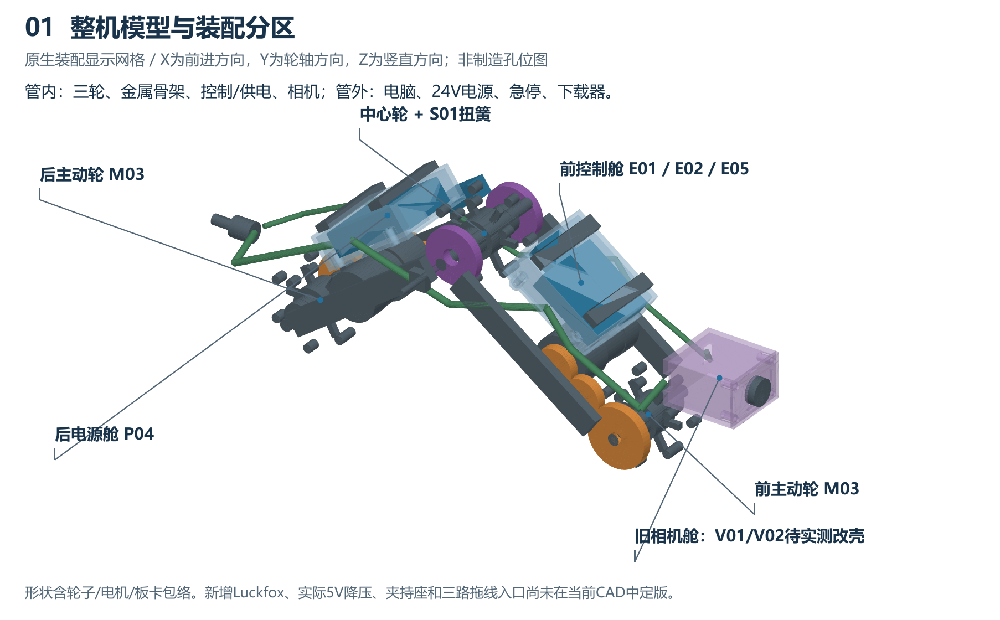
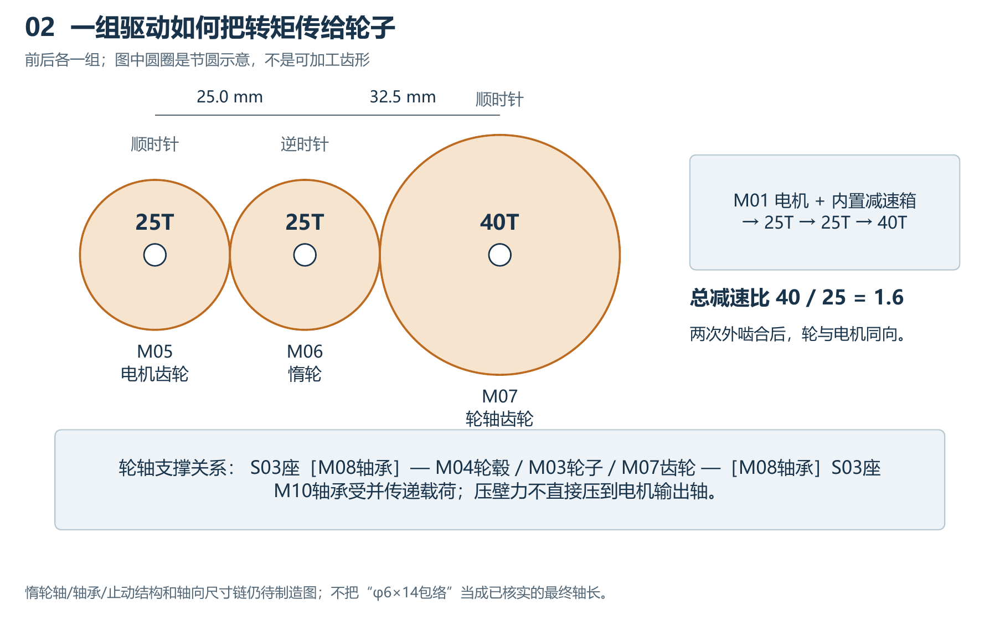
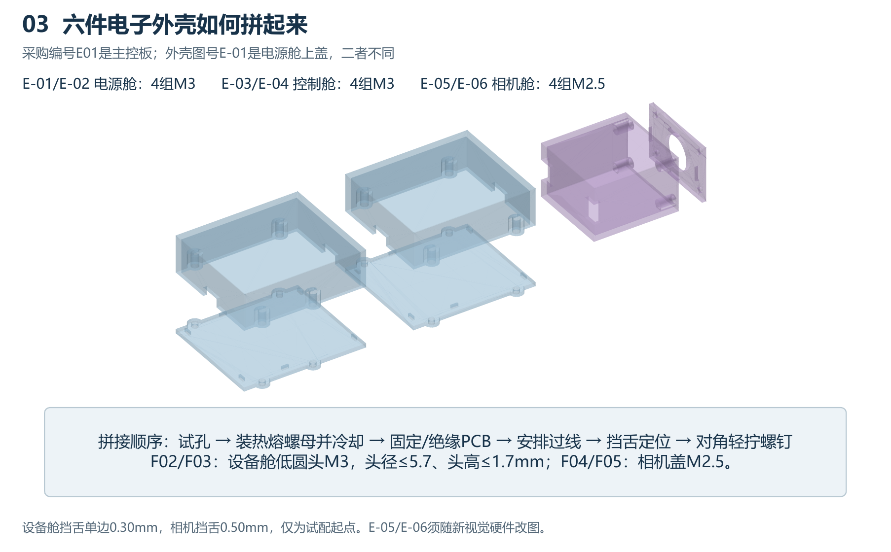
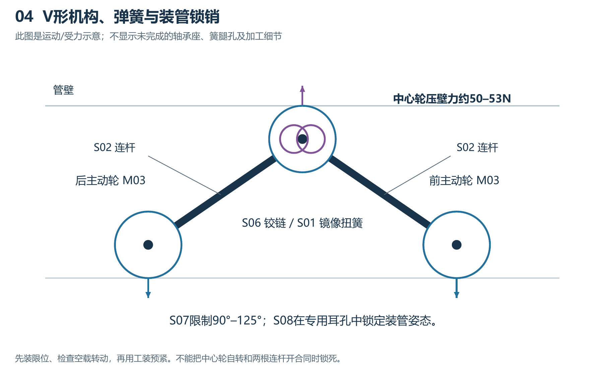
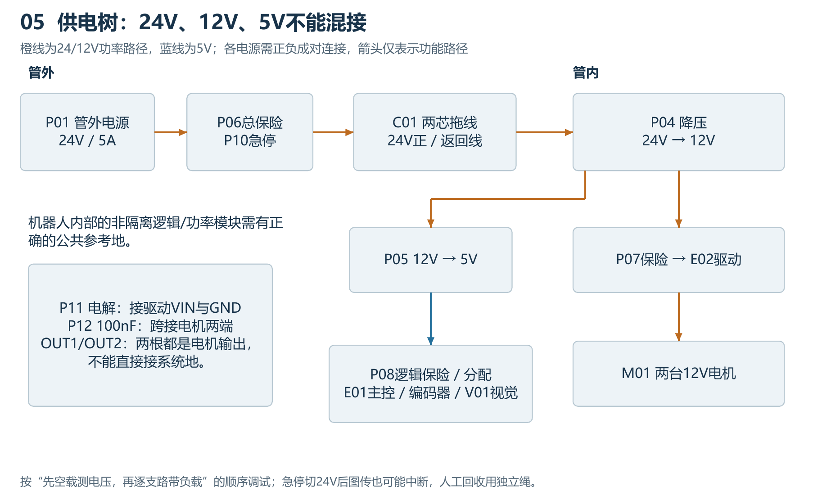
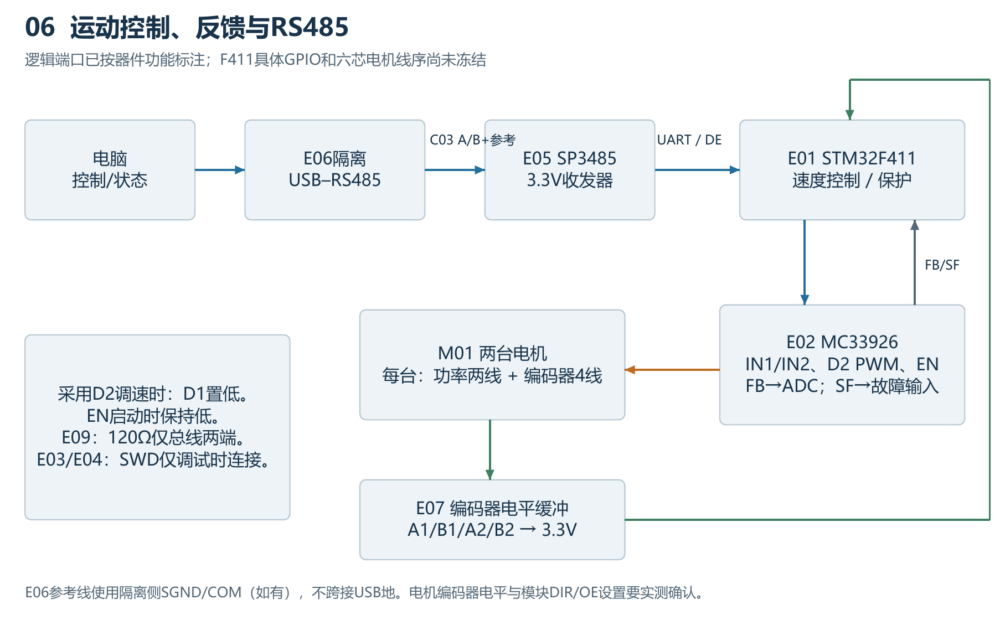
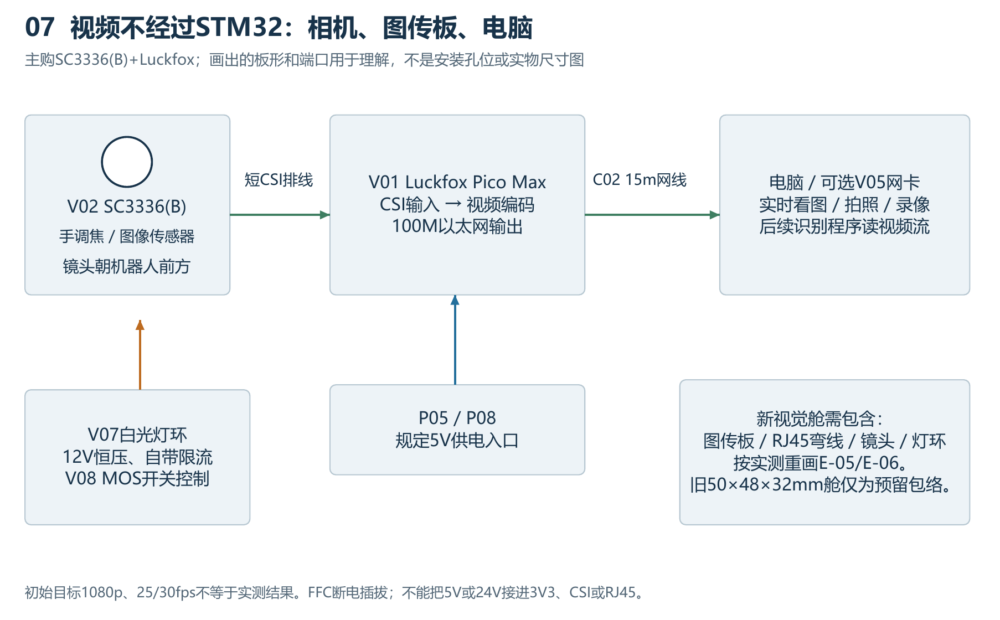
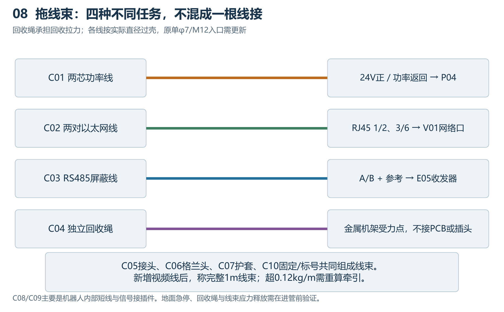

# 87项器材讲解与装配图解

> 历史装配图解：本文及配套图片、PDF 基于 [6ad9346 的后续修订模型](https://github.com/A123536/final-report/tree/6ad93463daccba81145dd6c9fa55dd463d4a2adb/cad/solidworks/model)，不对应 2026-11-03 选定的 2026-10-13 当前模型。

本说明与2026-10-28采购清单使用相同编号。采购E01是主控板；外壳E-01是电源舱上盖。

原生模型未修改。新增视觉硬件、5V降压、机架夹持和三路拖线入口仍需实测与制造级设计。

## 电控

### E01 运动主控板

型号：WeAct MiniF4 STM32F411CEU6 V3.1。装机1块，建议采购2块；现在买。

- 作用：读取两台电机的编码器，计算转速，再输出PWM、方向和使能；它相当于运动控制大脑，不负责视频编码。
- 位置：前侧控制舱，绝缘柱安装。
- 连接：5V从开发板允许的5V入口进入；逻辑为3.3V。连接E02、E05、E07和调试线。
- 装配要点：先做台架和引脚分配；本仓库尚无冻结的IOC，不能按示意图随便选GPIO。

### E02 双路有刷电机驱动

型号：Pololu Dual MC33926 Motor Driver Carrier #1213。装机1块，建议采购1块；现在买。

- 作用：把低功率控制信号变成两路可正反转的电机电流，并输出电流反馈和故障状态。
- 位置：前侧控制舱，远离易受热塑料和信号线。
- 连接：12V接VIN/GND；两对OUT1/OUT2各接一台电机。VDD使用3.3V；IN1/IN2、D2/PWM、EN、FB、SF接主控功能端口。
- 装配要点：采用D2调速时D1须保持低；启动时EN保持低。SLEW等剩余脚依厂家说明设置，不能悬空猜测。

### E03 STM32下载调试器

型号：STLINK-V3MINIE 原装。装机1个，建议采购1个；现在买。

- 作用：给STM32下载固件、设置断点和查看程序状态；只在开发调试时接入。
- 位置：电脑旁或管外，不随机器人进入管道。
- 连接：电脑USB-C连调试器，STDC14经E04接主控SWD。
- 装配要点：VTref用于电平参考，不把它当作整个机器人电源。调试器不等于运动主控。

### E04 SWD转接线

型号：STDC14 1.27mm转2.54mm SWD转接板/线。装机1套，建议采购1套；现在买。

- 作用：把调试器的小间距插座转换为主控可接的SWD线序。
- 位置：管外调试线。
- 连接：SWDIO对SWDIO，SWCLK对SWCLK，GND共地，VTref接目标3.3V参考，按需连NRST。
- 装配要点：以所购转接板针脚定义为准，不凭线色判断；断电核对后连接。

### E05 机器人RS485收发器

型号：Waveshare RS485 Board (3.3V)，SP3485。装机1块，建议采购2块；现在买。

- 作用：把主控的3.3V串口信号转换成适合长拖线的差分RS485信号。
- 位置：前控制舱，靠近通信线入口但与电机功率线分开。
- 连接：UART TX→DI，RO→UART RX；DE/RE按方向控制；A/B及参考线通过C03到电脑端。
- 装配要点：3.3V供电；核对终端电阻是否已安装。接收与发送方向要切换，DMA结束不等于最后一位已经发完。

### E06 电脑USB转RS485

型号：Waveshare USB TO RS485/422 隔离版。装机1个，建议采购1个；现在买。

- 作用：让电脑通过USB收发RS485控制命令和机器人状态。
- 位置：管外电脑端。
- 连接：USB接电脑；RS485侧A/B对接机器人A/B，参考线按隔离侧SGND/COM说明接。
- 装配要点：厂商A/B命名可能不同，按手册核对极性。不要跨接USB地来破坏隔离。

### E07 编码器电平转换

型号：SN74LVC245A 3.3V转换模块。装机1块，建议采购1块；现在买。

- 作用：将可能为5V的编码器输出缓冲成3.3V，保护主控输入。
- 位置：控制载板附近，尽量靠近接收端。
- 连接：模块以3.3V供电，编码器A/B接输入，输出接F411两组编码器功能输入。
- 装配要点：固定正确DIR并使能OE；先确认开漏/推挽。买到的模块若只是74HC245不能当作同规格替代。

### E08 USB数据线

型号：USB-A/USB-C至USB-C，带数据功能。装机2根，建议采购3根；现在买。

- 作用：提供烧录、日志和板卡短距离调试连接。
- 位置：管外台架。
- 连接：分别接调试器、主控或Luckfox对应USB口。
- 装配要点：必须带数据线芯；不是15m图传拖线。避免外部5V与电脑USB电源未经确认同时反灌。

### E09 RS485终端电阻

型号：120Ω、0.25W、1%。装机2只，建议采购10只；现在买。

- 作用：在RS485线缆两端匹配阻抗，减轻反射。
- 位置：总线物理两端各一处。
- 连接：每只120Ω跨接A和B。
- 装配要点：已有模块终端时不再重复并联；不能在每个中间连接点都加一只。

### E10 控制载板

型号：2.54mm小型洞洞板/定制载板。装机1块，建议采购2块；现在买。

- 作用：为主控、收发器、缓冲与接插件提供牢固的安装和焊接基础。
- 位置：控制舱内部。
- 连接：承接各板电源和信号；高电流分配使用额定合格的铜线或P14。
- 装配要点：先布板再钻安装孔；高电流不要经过细洞洞板线条，也不用面包板进管。

## 动力传动

### M01 编码减速电机

型号：Hiwonder JGB37-520R90-12，带AB编码器。装机2台，建议采购2台；现在买。

- 作用：两台12V编码减速电机分别驱动前、后主动轮；编码器提供转速反馈。
- 位置：前后驱动模块的左右相反侧。
- 连接：电机两线接E02各一路输出；编码器供电、地和A/B接逻辑支路与E07。
- 装配要点：新推荐R90-12堵转3.2A；安装孔、偏心轴和电流曲线需实测。不能把电机两根线中的一根直接当GND。

### M02 电机配套6芯线束

型号：与所购JGB37编码器配套的原厂插头线。装机2根，建议采购4根；现在买。

- 作用：把每台电机的两根功率线与四根编码器线引出。
- 位置：从电机到控制载板之间，固定在机架上。
- 连接：按原厂六线定义分别进入驱动、电源和编码器接收电路。
- 装配要点：先核对线序/插头间距，不能按颜色套用另一家电机。功率线和编码器线分束。

### M03 φ60普通全向轮

型号：定制90°全向轮：φ60、轮体宽≤28、φ8轮毂适配。装机3只，建议采购3只；先确认。

- 作用：三只轮子负责接触管壁；前后轮推进，中心轮被弹簧向上压紧。小滚子允许横向顺应。
- 位置：前后位于管道下方，中心轮位于上方。
- 连接：通过轮毂、轴和轴承连接金属支架；两端主动轮再接传动齿轮。
- 装配要点：普通90°全向轮不是45°麦克纳姆轮。单轮约80N允许径向载荷是询价目标，现未核实直接适配商品。

### M04 φ8夹紧轮毂

型号：φ8夹紧式轮毂，法兰孔型按实际全向轮。装机3只，建议采购3只；先确认。

- 作用：把轮子与轮轴连接并传递转矩，维持轮的同心度。
- 位置：轮芯与φ8轴之间。
- 连接：主动轮由夹紧轮毂连接轮轴；中心轮还需保持独立转动，不把两连杆和轮子锁成一体。
- 装配要点：孔型、夹紧长度、外径须配实际轮子；按最终轴承/关节结构确定，不只靠顶丝传全部转矩。

### M05 电机25齿齿轮

型号：m=1、z=25、20°直齿、φ6 D孔、有效齿宽7mm。装机2只，建议采购2只；图纸后加工。

- 作用：25齿电机齿轮是外级传动的输入件。
- 位置：每台电机φ6 D形输出轴上。
- 连接：与M06的25齿惰轮啮合，中心距25.0mm。
- 装配要点：模数1、20°压力角、有效齿宽7mm；孔、轮毂与实际轴伸配套，不能只拿外径选齿轮。

### M06 25齿惰轮

型号：m=1、z=25、20°直齿、φ6孔、有效齿宽7mm。装机2只，建议采购2只；图纸后加工。

- 作用：25齿惰轮把电机移离轮子，为齿轮箱腾出空间；它不改变40/25的总传动比。
- 位置：电机轴与轮轴之间。
- 连接：一边啮合M05，另一边啮合M07；与M11轴和M09轴承成套设计。
- 装配要点：必须明确谁固定、谁旋转。本图以齿轮带轴转、轴承外圈固定在支架上解释；最终按制造图，不把轴和齿轮都锁死。

### M07 40齿轮轴齿轮

型号：m=1、z=40、20°直齿、φ8孔、有效齿宽7mm。装机2只，建议采购2只；图纸后加工。

- 作用：40齿轮轴齿轮输出更低转速和更大转矩。
- 位置：两根主动轮轴上，与惰轮同一齿宽平面。
- 连接：与M06啮合，中心距32.5mm；经M10/M04带动车轮。
- 装配要点：齿轮轴向对齐，轮子受到的压壁力由轴承支撑，不由电机输出轴直接承受。

### M08 主轴轴承

型号：619/8-2RS1（SKF）或同尺寸698-2RS。装机6只，建议采购8只；现在买。

- 作用：六只主轴轴承支撑三根轮轴，使转动顺畅并把径向轮载传到机架。
- 位置：每根轮轴左右各一只。
- 连接：内圈配轴，外圈配S03轴承座。
- 装配要点：8×19×6mm；压装时只对相应圈施力，不通过滚珠传压装力。不能替换为608。

### M09 惰轮轴承

型号：686-2RS，正规轴承商。装机2只，建议采购4只；现在买。

- 作用：支撑惰轮轴的旋转，避免齿轮只靠薄板孔摩擦。
- 位置：每组惰轮的S05轴承座中。
- 连接：内圈配φ6轴，外圈固定在惰轮支架。
- 装配要点：6×13×5mm；轴必须穿过有效支撑宽度并留止动空间，14mm旧轴长只是待完善包络。

### M10 φ8轮轴/中心轴

型号：45钢精磨轴，按制造图车削。装机3根，建议采购3根；图纸后加工。

- 作用：两根主动轴传递轮端转矩，一根中心轴为轮/铰链提供共轴基准。
- 位置：三个轮轴位置。
- 连接：连接轮毂、轴承、齿轮、轴向垫片及止动结构。
- 装配要点：概念74/74/92mm不是加工放行长度；先完成轴肩、槽位、公差和整个轴向尺寸链。

### M11 φ6惰轮轴

型号：45钢精磨轴，按制造图车削。装机2根，建议采购2根；图纸后加工。

- 作用：惰轮的φ6轴把齿轮旋转传给轴承支撑。
- 位置：两个惰轮中心。
- 连接：连接M06、M09及止动件；由S05定位。
- 装配要点：概念长14mm不等于已有完整装配尺寸，不能拿普通螺钉螺纹段当精密轴颈。

### M12 薄壁轴向调整垫片

型号：φ8内孔，0.2/0.5/1.0mm混合。装机12片，建议采购30片；先确认。

- 作用：微调齿轮与轴承的轴向位置，消除过度窜动又不夹死转动件。
- 位置：轮轴的轴肩、轴承内圈或止动件之间。
- 连接：配M10及实际轴端结构使用。
- 装配要点：只接触需定位的环面，不压轴承密封圈；试转后再锁紧。

### M13 φ8轴端挡圈

型号：DIN471 φ8轴用挡圈。装机6只，建议采购20只；先确认。

- 作用：在采用挡圈方案时限制轴向零件滑脱。
- 位置：制造图指定的φ8轴端槽内。
- 连接：与轴槽及M12垫片共同确定轴向间隙。
- 装配要点：槽径/槽宽和轴长先确认；若最终改用轴肩/螺母方案，本项不一定使用。

## 结构弹簧

### S01 镜像扭簧

型号：定制左旋+右旋各一根。装机2根，建议采购2根；先确认。

- 作用：左右镜像扭簧给V形机构预紧力，让中心轮保持压壁。
- 位置：中心铰链两侧，对称布置。
- 连接：一端簧腿固定到一侧连杆座，另一端到另一侧受力座，具体绕向与锚点由制造图确定。
- 装配要点：先装机械限位再在工装中预紧；不要凭OD38/ID12/W6.4包络直接绕制或徒手扭到目标角。

### S02 连杆导轨

型号：6061-T6，4件，按制造图加工。装机4件，建议采购4件；图纸后加工。

- 作用：四条金属导轨组成前后两根刚性连杆，保持150mm轴距并承载轮载。
- 位置：每根连杆左右各一条。
- 连接：连接轮轴支撑、电机/惰轮支架与中心关节。
- 装配要点：122×7×16是当前实体包络，端部耳和孔位未完成；3mm铝片不是现轨道的直接替代。

### S03 主轴轴承座

型号：6061-T6，按619/8和轮轴结构定制。装机6件，建议采购6件；图纸后加工。

- 作用：把主轴轴承外圈固定在金属结构上，并把管壁力传入连杆。
- 位置：三根轴的左右支撑位置，共六个座位。
- 连接：容纳M08，定位到S02或中心铰链。
- 装配要点：轴承孔、双侧同轴度、端面和紧固面需制造图，不能靠软PETG壳代替精密座。

### S04 电机支架

型号：JGB37法兰匹配支架，6061-T6。装机2件，建议采购2件；图纸后加工。

- 作用：固定电机法兰，使电机齿轮中心距保持稳定。
- 位置：前后驱动模块上。
- 连接：连接电机法兰与金属连杆，同时定位M05相对惰轮轴。
- 装配要点：核对电机偏心输出轴、螺孔与轴伸；固定好再调齿隙。

### S05 惰轮支架/轴承座

型号：按686轴承和φ6轴定制。装机2套，建议采购2套；图纸后加工。

- 作用：固定惰轮轴承，保持两次啮合的中心距与齿宽对齐。
- 位置：电机与轮轴之间的金属支架。
- 连接：连接M09及S02/S04；定位M11。
- 装配要点：先保证刚度和同轴度，再确定单/双支撑；不要把轴承外圈也随齿轮锁着转。

### S06 中心铰链/簧腿座

型号：6061-T6中心轴套、左右簧腿固定座。装机1套，建议采购1套；图纸后加工。

- 作用：让前后连杆绕中心轴改变V角，同时为簧腿提供受力锚点。
- 位置：中心被动轮附近。
- 连接：连接中心轴、连杆、扭簧和限位件。
- 装配要点：轮的自转和连杆的开合是两个运动要求；最终关节不能互相夹死。

### S07 机械限位与锁销座

型号：90°/125°限位块与φ4销孔座。装机1套，建议采购1套；图纸后加工。

- 作用：限制V角在允许范围，并为装管锁销提供可靠的定位耳。
- 位置：中心关节附近。
- 连接：90°/125°机械限位与S08配套。
- 装配要点：先完成机械止挡再装预紧弹簧；模型中相交的限位连接包络不等于现成加工孔。

### S08 装管快拔销

型号：φ4mm有效长度约40mm，带拉环和防丢绳。装机1支，建议采购2支；先确认。

- 作用：把机构临时锁在装管姿态，进入管后再释放弹簧压紧。
- 位置：中心关节的专用锁销耳孔。
- 连接：φ4销穿过配套耳孔，防丢绳固定到机架。
- 装配要点：确认销不穿轮、电机或线束。操作前使机构卸载并按工装步骤控住弹簧力。

### S09 自加工铝料（备选）

型号：6061-T6扁条8×20×600mm。装机0条，建议采购0条；可选。

- 作用：供学校自行加工金属轨道的可选坯料。
- 位置：加工台，不是额外装入机器人的一条杆。
- 连接：加工成S02等已出图零件。
- 装配要点：默认外协包料不买；没有制造图先不要把材料切成最终长度。

### S10 电子舱机架夹持件

型号：独立夹持座/金属束带，按实物设计。装机1套，建议采购1套；图纸后加工。

- 作用：把各电子舱固定到金属机架，并提供线束应力释放点。
- 位置：电源舱、控制舱与前端相机舱周围。
- 连接：夹持外壳/底板并连接S02；回收绳固定到金属受力处。
- 装配要点：六件式壳体只解决自身合盖；夹持座、孔位和新视觉模块载荷仍待设计。

## 供电保护

### P01 地面24V电源

型号：MEAN WELL GST120A24-P1M。装机1只，建议采购1只；现在买。

- 作用：在地面把市电转换为24V直流，降低长线上的输电电流和压降。
- 位置：管外。
- 连接：成品AC线输入；24V经P03、保险和急停进入C01。
- 装配要点：使用封闭成品电源；P1M输出中心正。不要把市电布入机器人。

### P02 交流输入线

型号：正规国标三脚至IEC C13电源线。装机1根，建议采购1根；现在买。

- 作用：把地面插座与封闭电源的C14入口连接。
- 位置：管外电源输入端。
- 连接：国标成品插头→IEC C13插头。
- 装配要点：使用完整成品接地电源线，不改裸露市电接线。

### P03 DC输入转接线

型号：5.5×2.5mm母座至XT30U成品线。装机1根，建议采购2根；现在买。

- 作用：将桌面电源DC插头转换为可靠的主线连接器。
- 位置：地面电源输出附近。
- 连接：5.5×2.5mm母座→XT30U→保险/急停。
- 装配要点：先测中心正与线序；负载时查接头温升，2.1mm与2.5mm不能混配。

### P04 24V转12V降压

型号：Pololu D42V110F12 #5677。装机1块，建议采购1块；现在买。

- 作用：在机器人上把长拖线来的24V降成12V电机母线。
- 位置：后侧电源舱，绝缘固定并留散热空间。
- 连接：VIN/GND接C01机器人端；12V/GND输出送P07电机支路和P05逻辑降压。
- 装配要点：先空载测12V，再带负载。所购43.2×31.8×9mm板与旧65×42×17占位不同，需要重排孔位。

### P05 12V转5V降压

型号：Pololu D24V50F5 #2851。装机1块，建议采购1块；现在买。

- 作用：把12V转换成逻辑和视觉所需的5V，减少电机噪声对控制供电的影响。
- 位置：建议靠近逻辑/视觉分配点，位置待实物布板。
- 连接：输入接12V母线，5V经P08分给主控允许入口、编码器规定电源与Luckfox 5V入口。
- 装配要点：先验证电压和启动压降；不能把5V接到任何3V3脚。该板尚未在旧CAD里完整定位。

### P06 地面总保险丝座

型号：成品DC保险座，配5A慢断保险。装机1套，建议采购2套；现在买。

- 作用：主线异常过流时保护地面电源后的线缆。
- 位置：靠近地面24V输出端。
- 连接：串在24V正线上；不得跨接正负极。
- 装配要点：额定DC电压、电流和线径配套；与实际电源限流/导线能力协调，不能把它当电机限流器。

### P07 12V电机支路保险

型号：成品DC保险座，5A起始测试值。装机1套，建议采购1套；现在买。

- 作用：把两台电机的12V功率支路与逻辑支路区分开。
- 位置：机器人电源分配点，靠近驱动支路起点。
- 连接：串在12V→E02 VIN的正线。
- 装配要点：5A仅起始选值；软件限流、故障监控和堵转切断仍需验证。

### P08 5V逻辑支路保护

型号：DC小型保险座，配2A/3A保险各一组。装机1套，建议采购1套；现在买。

- 作用：保护5V逻辑/视觉支路，便于单独定位短路。
- 位置：P05输出附近。
- 连接：串在5V正线，之后分到主控、视觉及编码器规定电源。
- 装配要点：2A/3A按视觉启动电流和导线能力确定，不直接照抄为已验证值。

### P09 保险丝备件

型号：5A慢断、2A/3A，与所购座同规格。装机1盒，建议采购1盒；现在买。

- 作用：替换已确认熔断的保险，支持调试备件需求。
- 位置：备件袋，不装在额外电路位置。
- 连接：按P06/P07/P08所用尺寸、DC额定与快慢断属性替换。
- 装配要点：先排除短路原因再换保险，不用更大电流型号掩盖故障。

### P10 地面急停

型号：自锁蘑菇头急停+DC额定≥24V/5A触点或成品急停盒。装机1套，建议采购1套；现在买。

- 作用：让操作者立即切断进入机器人的24V电源。
- 位置：管外操作者可随时触及的位置。
- 连接：额定合格的常闭开断触点串入主24V正线，按成品盒接法使用。
- 装配要点：切断供电后视频也可能中断；回收依靠C04，不依靠软件反转自救。

### P11 驱动输入储能电容

型号：低ESR 1000µF/25V或35V电解。装机1只，建议采购4只；现在买。

- 作用：在驱动器附近缓冲电源短时波动。
- 位置：E02的VIN/GND附近，短引线、牢固固定。
- 连接：电解正极接12V VIN，负极接GND。
- 装配要点：极性不能反；额定25/35V并核对空间。不能并到电机OUT1/OUT2之间。

### P12 电机抑制电容

型号：100nF/50V X7R或薄膜。装机2只，建议采购10只；现在买。

- 作用：减轻有刷电机端子产生的高频干扰。
- 位置：每台电机的两个功率端子附近。
- 连接：100nF跨接两电机端子，不替代编码器旁路或12V储能电容。
- 装配要点：引线尽量短并绝缘固定，避免碰壳或转轴。

### P13 电源连接器

型号：AMASS XT30U 公母对，正规商家。装机4对，建议采购6对；现在买。

- 作用：提供可拆且不易误插的低压功率连接。
- 位置：主电源和两台电机支路的可维修接合处。
- 连接：成对焊接正负功率线；电机输出对按电机线标记。
- 装配要点：电机输出不是固定正负母线；分别编号M1/M2，信号插头用不同形状防错。

### P14 电源分配与开关小板

型号：额定≥5A小型端子/焊接分线板。装机1套，建议采购1套；现在买。

- 作用：把24V、12V、5V及其返回线分配到各支路。
- 位置：电源舱/控制载板的固定分线位置。
- 连接：形成图05中的分支；功率回流与小信号参考采用明确的公共参考点。
- 装配要点：不能把24V、12V、5V正极连在一起；高电流不经杜邦线或面包板。

## 视觉图传

### V01 图传主板

型号：Luckfox Pico Max（RV1106G3，256MB版本）。装机1块，建议采购1块；现在买。

- 作用：接收相机图像、编码并通过网络发给电脑；它是图传处理板，不是运动主控。
- 位置：计划在新相机舱或相邻独立支架；当前CAD未定位。
- 连接：短CSI排线接V02；以太网接C02；规定5V入口接P05/P08。
- 装配要点：先用厂家系统和短线看RTSP，再上长拖线。不能把整套硬件硬塞进旧相机壳。

### V02 配套相机

型号：Waveshare SC3336 3MP Camera (B)。装机1套，建议采购1套；现在买。

- 作用：把光学图像变成数字视频，手调焦用于管内近距离观察。
- 位置：机器人前端，镜头朝前；要看侧壁需依视场和实际工作距离验证。
- 连接：只用匹配CSI线接Luckfox；灯板另供电。
- 装配要点：断电插拔FFC；接口方向按厂家图片核对。不要当通用USB或树莓派相机来接。

### V03 CSI排线备件

型号：SC3336与Luckfox原厂匹配FFC。装机0根，建议采购1根；现在买。

- 作用：备用相机与图传板之间的短排线。
- 位置：相机舱内部，不沿15m拖线铺设。
- 连接：与V01/V02同版本的原厂匹配线。
- 装配要点：卡扣打开后均匀插入，固定后留弯曲余量；不拉扯、不带电插拔。

### V04 启动/本地录像卡

型号：SanDisk High Endurance microSD 32GB（或同级）。装机1张，建议采购1张；现在买。

- 作用：保存系统备份或按配置保存本地录像。
- 位置：Luckfox的microSD卡槽。
- 连接：按所用系统启动/存储配置使用。
- 装配要点：插卡不等于自动录像；长时间使用先测试文件写入、掉电恢复与容量。

### V05 电脑USB网卡

型号：TP-LINK UE300 或同级标准USB千兆RJ45网卡。装机0个，建议采购0个；可选。

- 作用：为没有RJ45口的电脑提供以太网接口。
- 位置：管外电脑端。
- 连接：USB接电脑，RJ45接C02或近端调试线。
- 装配要点：电脑已有网口时可省略；与E06 USB-RS485是两种不同设备。

### V06 近端调试网线

型号：成品纯铜Cat5e/Cat6 RJ45，1–2m。装机1根，建议采购2根；现在买。

- 作用：用于最初调通视频和诊断长线问题。
- 位置：台架，电脑与Luckfox之间。
- 连接：正常成品网线直接连两端的RJ45。
- 装配要点：短线通了再换C02；普通跳线不作为长期反复弯曲拖线。

### V07 白光补光灯板

型号：12V恒压白光环形板，外径约30–36mm、内径≥20mm。装机1块，建议采购2块；先确认。

- 作用：给黑暗管内提供可控的白光，保证曝光和颜色可辨。
- 位置：镜头周围，但不侵入光路。
- 连接：12V灯板经V08开关供电，自带限流；不从相机固定孔取电。
- 装配要点：先低功率常亮试反光和发热，再定环径/位置；旧32mm高前盖可能装不下所选灯环。

### V08 补光开关

型号：AO3400A逻辑电平MOS开关模块。装机1块，建议采购2块；现在买。

- 作用：让主控用小电流控制较高电流的灯板开关。
- 位置：控制载板或补光附近。
- 连接：模块的额定负载端串入灯板供电回路，控制输入接3.3V功能输出并共参考地。
- 装配要点：以模块实测/原理图核对负载正负和触发方式；调光时检查画面是否出现条纹。

### V09 灯板柔光件

型号：乳白扩散片/磨砂PC薄片。装机1片，建议采购1片；先确认。

- 作用：把灯珠的点状强光变柔，减少高光和照度不均。
- 位置：灯环前方，镜头有效视场以外。
- 连接：机械固定在新前盖上，不接电。
- 装配要点：不要磨砂镜头窗或覆盖镜头；用实物看是否引入反光后再定形。

### V10 镜头保护窗（选配）

型号：光学透明PC/玻璃片，按最终前盖。装机0片，建议采购0片；可选。

- 作用：在需要时保护镜头免受碰擦和污染。
- 位置：新相机前盖的独立窗框中。
- 连接：与镜头之间留实际净空，机械固定，不接电。
- 装配要点：镜头凸出量、窗口反射和密封未设计，不能直接贴片后宣称防水。

## 拖线线束

### C01 24V拖线电源线

型号：高柔纯铜2×0.75mm²拖链线。装机15米，建议采购18米；现在买。

- 作用：把管外24V直流传到机器人，给所有板卡和电机供能。
- 位置：15m拖线束中。
- 连接：两根铜芯分别是24V正与功率返回线，机器人端接P04。
- 装配要点：做好应力释放和极性标记，测整段压降；不把它与以太网RJ45混接。

### C02 以太网图传拖线

型号：LAPP ETHERLINE FD P CAT.5e 2170289，2×2×AWG26/19。装机15米，建议采购18米；现在买。

- 作用：传输已编码的视频和网络数据。
- 位置：拖线束中与功率线分开固定。
- 连接：RJ45数据对1/2和3/6接匹配的100M端口；屏蔽和接头按线厂说明。
- 装配要点：这是数据线，不是24V供电口；在本方案中不用PoE，也不借空闲芯做未经设计的供电。

### C03 RS485拖线

型号：120Ω特性阻抗高柔屏蔽双绞线，2对×0.22mm²。装机15米，建议采购18米；现在买。

- 作用：传输运动命令、速度、电流和故障状态；不传高清视频。
- 位置：独立RS485拖线。
- 连接：一对A/B，另设参考线，端接E05和E06隔离侧。
- 装配要点：避免长支线和星形分叉，终端电阻在物理两端。参考与屏蔽接法按最终电路图。

### C04 回收绳

型号：芳纶绳φ1.5–2mm，供应商额定拉力≥50kgf。装机15米，建议采购18米；现在买。

- 作用：断电或卡住时用于人工回收，并让拖拽力绕开导体与焊点。
- 位置：沿拖线束布置，独立固定到金属机架。
- 连接：机器人端接金属受力点，地面端由操作者管理。
- 装配要点：不要绑在PETG薄盖、电机编码器线或RJ45插头上；结节与冲击会降低实际承载能力。

### C05 网线接头/护套

型号：适配AWG26/19多股、5.9mm线径的屏蔽RJ45。装机2套，建议采购6套；现在买。

- 作用：将高柔以太网线可靠连接到两个RJ45端口。
- 位置：图传拖线两端。
- 连接：接头型号匹配细多股AWG26/19线，完成线对与100M链路测试。
- 装配要点：不能用实心线专用端子凑合，也不只测直流通断就认定高速数据可靠。

### C06 格兰头/应力释放

型号：M12/M16多规格试装包，按每根线实测外径。装机3只，建议采购6只；先确认。

- 作用：让电缆过壳处防磨并分担外部拉力。
- 位置：机器人入口、地面盒或独立金属应力释放夹。
- 连接：按各线外径分别夹持；接线前先把格兰头穿在线上。
- 装配要点：M12/M16是螺纹规格，不直接等于可夹持线径。旧单φ7入口须修改。

### C07 编织保护套

型号：轻质可扩张PET编织套，适配三线束外廓。装机15米，建议采购18米；先确认。

- 作用：把多根拖线整理成易管理的束，并减轻表面磨损。
- 位置：拖线束外侧。
- 连接：与电源、网线、485及回收绳一起宽松固定。
- 装配要点：完整束含护套/绳称重，超过0.12kg/m须重算牵引；不要勒出硬折点。

### C08 柔性短线

型号：多股硅胶线AWG20/22，红黑各3m。装机1包，建议采购1包；现在买。

- 作用：连接机器人内部的短距离低压功率支路。
- 位置：电源舱到驱动/电机之间。
- 连接：按实际电流配线径，经P13/P14形成可维修接合。
- 装配要点：不以AWG22短线代替15m主电源线；给关节处留柔性弯曲长度。

### C09 信号连接器

型号：JST-GH 1.25mm 4/6芯成品端子线套装。装机1包，建议采购1包；现在买。

- 作用：让低电流信号与小板可拆装，同时减少杜邦线松脱。
- 位置：控制载板与编码器/模块信号接口处。
- 连接：配合新做的信号接口，不强配电机原插座。
- 装配要点：先定针脚定义，标出电压和方向；JST-GH不是所有JST系列的通用替代。

### C10 保护/固定耗材

型号：热缩管、软护边、号码管、小扎带、粘式底座。装机1套，建议采购1套；现在买。

- 作用：完成线束绝缘、标记、防磨和固定。
- 位置：全机线束、过壳口与金属边缘。
- 连接：热缩封焊点，号码管标电压/功能，护边隔开锐边，扎带固定在机架。
- 装配要点：盖壳前检查不夹线、不碰齿轮、不拉紧相机FFC；扎带不能代替可靠回收绳锚点。

## 打印紧固

### F01 打印耗材

型号：eSUN PETG，1.75mm，1kg（或同级PETG）。装机1卷，建议采购1卷；现在买。

- 作用：打印六个可拆电子外壳及试配件。
- 位置：打印机耗材，最终成为壳体；不是承力关节材料的默认替代。
- 连接：按已有STL毫米单位切片；新相机壳改图后重新切片。
- 装配要点：先打印孔径/挡舌试件。图03给出当前六件拆分关系，E-05/E-06是待更新视觉壳。

### F02 M3低圆头螺钉

型号：ISO7380-1 M3×10。装机8只，建议采购20只；现在买。

- 作用：把电源与控制舱底板压紧到上盖螺柱。
- 位置：两只设备舱底板外侧，共8只装机。
- 连接：穿过底板φ3.4通孔，拧进F03。
- 装配要点：低圆头尺寸必须满足D≤5.7/H≤1.7mm，不用高圆柱头替代，也不拧进裸PETG当长寿命螺纹。

### F03 M3热熔螺母

型号：M3、外径约4.6mm、长5mm的热熔嵌件。装机8只，建议采购20只；现在买。

- 作用：在PETG螺柱中提供可反复拆装的M3金属螺纹。
- 位置：两只上盖的四个螺柱内，共8只。
- 连接：冷却后的嵌件接F02螺钉。
- 装配要点：按实际嵌件试打底孔，垂直安装并保持端面；先冷却再上螺钉，防止柱壁歪斜。

### F04 相机盖螺钉

型号：M2.5×8内六角圆柱头。装机4只，建议采购20只；现在买。

- 作用：把相机前盖固定到主体。
- 位置：相机前盖的四个孔。
- 连接：通过前盖φ3.0孔进入F05。
- 装配要点：头D≤4.5/H≤2.5mm；修改相机壳后仍需重新核对长度和位置。

### F05 M2.5热熔螺母

型号：M2.5、长4–5mm热熔嵌件。装机4只，建议采购20只；现在买。

- 作用：为相机前盖提供可重复拆装的M2.5内螺纹。
- 位置：相机主体四个螺柱。
- 连接：与F04成对使用。
- 装配要点：先用所购嵌件验证暂定φ4.0底孔；不把加热的嵌件推入镜头/PCB空间。

### F06 内部绝缘支撑

型号：M2/M2.5/M3尼龙柱、螺母、绝缘垫片混合包。装机1套，建议采购1套；现在买。

- 作用：把PCB抬离外壳和金属面，避免短路并留出底部焊点空间。
- 位置：板卡安装点下方。
- 连接：柱高与PCB孔径匹配，配绝缘垫片和适当螺钉。
- 装配要点：不要让固定螺钉压到走线或元件；两块板不能直接叠压在一起。

### F07 通用机械螺钉

型号：M3×6/8/12/16与M4×8/12/16套装。装机1盒，建议采购1盒；先确认。

- 作用：紧固金属支架、轴承座等制造件。
- 位置：最终制造图指定的安装孔。
- 连接：螺钉配平垫和锁紧螺母，按图控制伸出量。
- 装配要点：通用盒只是备料；最终长度不能顶到转轴/电机内部，也不能侵入管壁。

### F08 金属螺纹防松

型号：Loctite 243 小瓶或等效中强度金属螺纹胶。装机0瓶，建议采购0瓶；可选。

- 作用：需要时防止合适的金属螺纹因振动松动。
- 位置：已确认材料相容性的金属连接处。
- 连接：少量涂在指定金属螺纹，按胶说明固化。
- 装配要点：不随意涂PETG、透明窗或嵌件周边；优先使用明确的机械锁紧。

### F09 齿轮防护罩

型号：按最终传动尺寸打印/加工。装机2件，建议采购2件；图纸后加工。

- 作用：隔离两组齿轮啮合区，阻止线束和异物卷入。
- 位置：前后驱动模块外侧。
- 连接：固定在静止金属支架上，与齿轮、轴和管壁留实测间隙。
- 装配要点：不是六件电子壳之一，当前尚待出图；不能固定到旋转齿轮上。

## 调试工具

### T01 万用表

型号：优利德UT139C或同级，学校已有则不买。装机1台，建议采购1台；可选。

- 作用：检查电压、极性、通断和短路，帮助定位供电问题。
- 位置：台架工具，不装机。
- 连接：电压档并测目标节点与地；通断档只在断电时用。
- 装配要点：电流档不能直接跨接电源正负；先按仪表说明确认量程与保险。

### T02 游标/数显卡尺

型号：0–150mm，0.01/0.02mm读数。装机1把，建议采购1把；现在买。

- 作用：量轮子、轴、孔距、PCB、插头和外壳净空。
- 位置：测量工具，不装机。
- 连接：把实测数值记录给CAD和加工图。
- 装配要点：关键轴承配合还需加工方合适量具验收，不能只凭卡尺读数决定过盈。

### T03 恒温焊台与嵌件头

型号：带热熔螺母安装头的恒温电烙铁。装机1套，建议采购1套；可选。

- 作用：焊接线束与安装热熔螺母。
- 位置：加工台工具。
- 连接：配合焊锡、助焊剂和专用嵌件头使用。
- 装配要点：电路断电后操作；按材料说明设温并排除废气，避免烙铁碰FFC或PCB塑料座。

### T04 手工具

型号：内六角1.5/2/2.5/3mm、螺丝刀、剪线/剥线工具。装机1套，建议采购1套；可选。

- 作用：完成螺钉紧固、剥线和端子制作。
- 位置：工具箱。
- 连接：使用与螺钉和端子匹配的刀头/压接模具。
- 装配要点：小内六角不要滑牙；端子压接后做拉力和通断检查，不只看外观。

### T05 USB串口

型号：CP2102N或CH343模块，3.3V TTL。装机1块，建议采购1块；现在买。

- 作用：读取Luckfox或STM32的串口日志，区别软件故障与线路故障。
- 位置：台架调试工具，不常驻机器人。
- 连接：3.3V TTL的TX接目标RX、RX接目标TX、GND接目标参考地。
- 装配要点：不是RS232或RS485；不要用小模块的5V引脚给整块视觉板供电。

### T06 称重工具

型号：0.1g读数电子秤，量程≥2kg。装机1台，建议采购1台；可选。

- 作用：检查整机和完整拖线束是否仍符合原仿真质量范围。
- 位置：台架测量工具。
- 连接：称整机及准确1m的完整线束，记录包含护套、回收绳和接头的条件。
- 装配要点：不把电源、485、网线单独重量漏算；超过1.8kg/0.12kg每米后重新评估。

## 实验材料

### T07 验证用管道

型号：内径实测140/150/160mm的PVC直管/透明管段。装机3段，建议采购3段；先确认。

- 作用：用短管检查140/150/160mm适应、装管动作、照明和线束通行。
- 位置：地面固定的试验台。
- 连接：每种先准备约1m实测内径管段，配T11支撑。
- 装配要点：DN是公称规格，不等于真实内径；先确认同心、无锐边，再做运动试验。

### T08 摩擦/牵引测量

型号：0–100N拉力计或电子测力计。装机1只，建议采购1只；可选。

- 作用：量轮管摩擦、拖线阻力和可用牵引力，用实测替代纯理论判断。
- 位置：试验台测力工具。
- 连接：按独立实验方法固定到受力点，测不同管径/表面的拉力。
- 装配要点：不把中心压壁力与整机牵引力混为同一个读数；避免冲击超过量程。

### T09 贴标与标定样片

型号：尺寸标尺、棋盘格、可移除裂纹/锈蚀模拟图。装机1套，建议采购1套；现在买。

- 作用：检查画面尺度、焦距、畸变和识别数据流程。
- 位置：管内可移除样片或台架标定板。
- 连接：摄像头拍摄标尺/棋盘格，电脑保存照片或视频。
- 装配要点：人工裂纹图片只验证处理流程，不能证明真实腐蚀/裂缝识别性能。

### T10 10m行走试验管补充段

型号：与T07标称150mm段相同实际内径的直管。装机9米，建议采购9米；先确认。

- 作用：在短管试验通过后形成10m有效行走路径。
- 位置：学校允许的直线试验场地。
- 连接：与T07中相同实测内径的150mm样段及T11连接。
- 装配要点：不要混用不同内径或形成明显接头台阶；短管未通过前不直接进入长管。

### T11 试验管支撑与连接

型号：可调管托、同心连接套及端部保护件。装机1套，建议采购1套；先确认。

- 作用：支撑并对齐试验管段，防止管道移动影响测试和回收。
- 位置：10m地面试验路径。
- 连接：管托与管径匹配，同心连接套连接各段，端部加保护。
- 装配要点：根据场地确认数量和间距；接头和管托不能干涉回收绳与操作者通行。

## 阅读顺序

先看图01分区，再看图02/04机械、图03外壳、图05/06电路、图07视觉和图08拖线；按PDF第09节的顺序逐步装配和上电。
